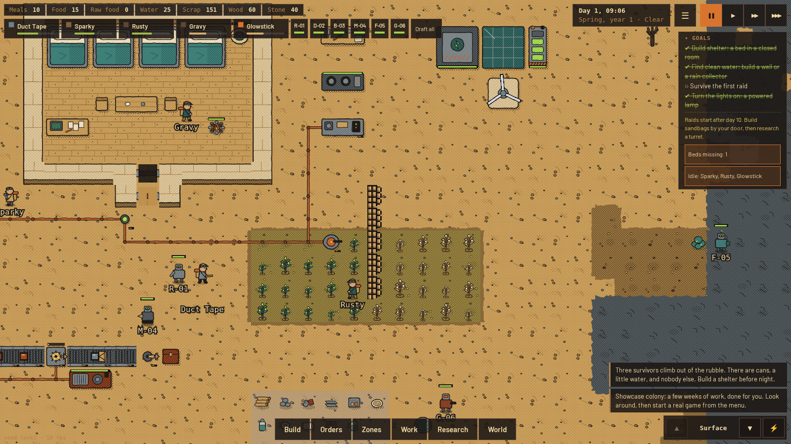
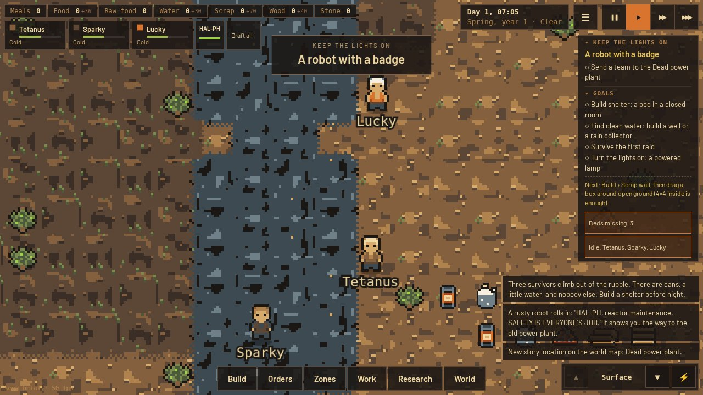
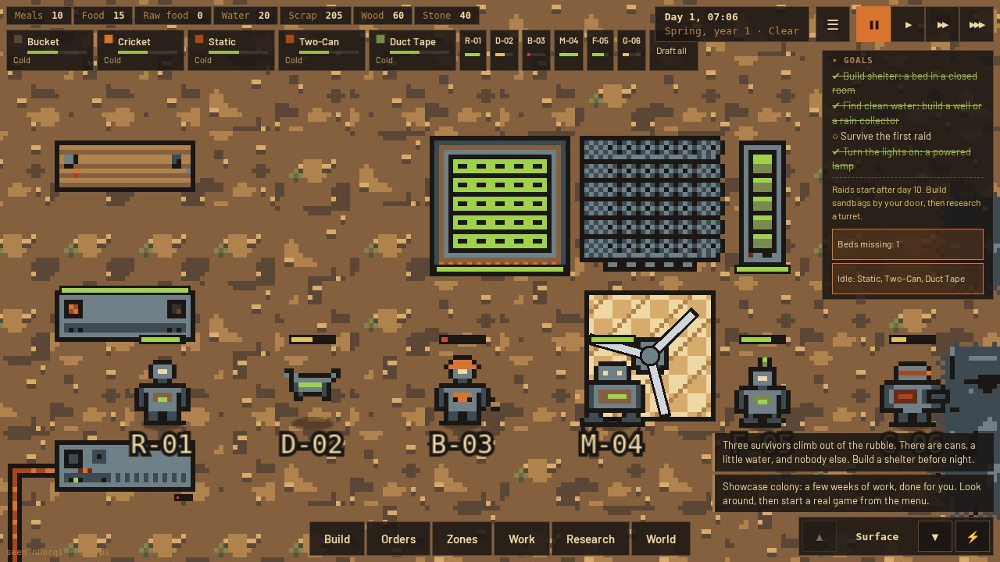
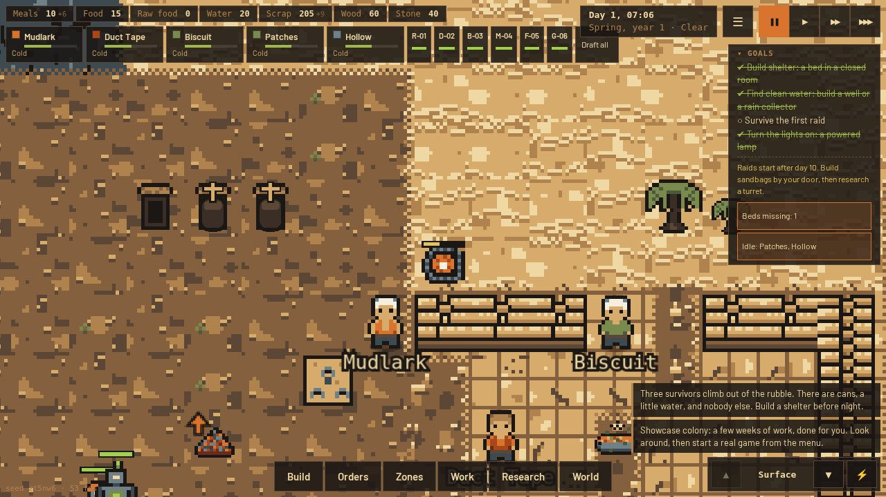
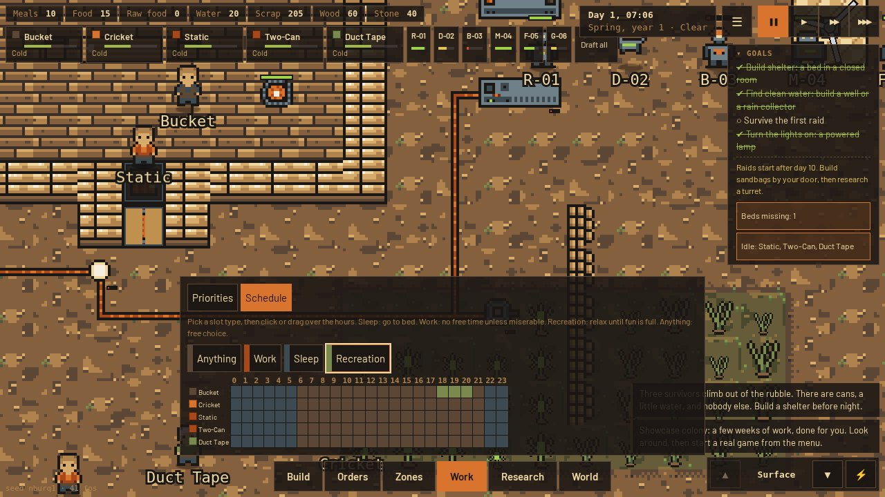

# Ash & Gears

**A post-apocalyptic colony sim with progressive automation.** RimWorld's people, Factorio's machines, the end of the world. It runs in the browser on PC and phone.



> **Play it in your browser:** use the website link in the *About* box of this repository (GitHub Pages). Nothing to install.

Three survivors climb out of the rubble. Salvage the old world, keep everyone fed and sane, survive raids and radiation clouds, and slowly let the machines do the work. You do not control anyone directly. You give orders, mark zones and set priorities. Your survivors decide the rest, and they have opinions.

## Features

- **Survivors with history:** needs, moods, skills, 30 traits, backstories, friendships, rivalries and romances. They sulk, get hurt, lose limbs, and sometimes become heroes.
- **Build anything:** drag rooms, walls, floors and furniture. Closed rooms get a roof and hold their heat.
- **Factory automation:** power grids with poles, switches, solar, wind and batteries. Belts, splitters, sorters, tunnels, robot arms, auto-crafters, an assembler, pipes, pumps and purifiers.
- **Robots:** builders, miners, farmers, guards and hauler drones. They charge at a robot bay. Raiders can hack them.
- **A wasteland that pushes back:** raiders, rad-rats, glow-hounds, fire, and radiation clouds that poison what you leave outside.
- **Three storylines with endings:** restart the old reactor, rebuild a school bus and drive to the safe zone, or signal the orbit. Win, and every survivor gets an ending slide.
- **Five start scenarios:** Sandbox, Lone Wanderer, Mall Rats, The Bunker, Rad Season.
- **A world outside:** a world map, expeditions, outposts, and four factions that trade or raid.
- **A colony that lives:** recreation, daily schedules, graves, fuel for fires, wood that grows back, food that spoils.
- **Mods:** content packs are plain JSON. See [docs/modding.md](docs/modding.md).
- **Hand-pixeled 16 px art** in three palettes, and adaptive music.

## Screenshots

| | |
|---|---|
|  |  |
| **Storylines** with chapters, goals and story places on the world map | **Robots** with charge bars, and a robot bay that stores power |
|  |  |
| **Colony life:** graves, fires that burn wood, trees for wood | **Schedules** for each survivor: sleep, work, recreation, anything |

## How to play

| Key | Action |
|---|---|
| Drag / WASD | Move the view |
| Wheel / pinch | Zoom |
| Space | Pause |
| 1 2 3 | Game speed |
| R | Draft or release the selected survivor |
| Right click | Move or attack with a drafted survivor |
| F | Default action on the selected tile |
| Q / E | Rotate belts and machines while placing |
| PgUp / PgDn | Surface or underground |
| P | Power overlay |
| Esc | Stop a tool, close panels |

New to colony sims? Follow the goals panel on the right. It guides you through the first days.

### Saves

Saves stay in your browser (IndexedDB). The game also autosaves. To keep a backup or to move a game to another device, use **Menu → Download save file**. To load it, use **Load from a save file** in the menu or on the title screen.

### URL options

`?showcase=1` opens a grown colony. `?seed=abc` sets the map seed. `?line=reactor|bus|orbit` starts a storyline. `?scen=lone|mall|bunker|rad_season` picks a scenario. `?palette=rust|toxic|ash` changes the palette.

## Run it yourself

You need Node.js 20 or newer.

```bash
npm install
npm run dev        # development server on http://localhost:5173/
npm run build      # production build in packages/client/dist
npm run preview    # serve the build on http://localhost:4173/
```

The development and preview servers bind to `0.0.0.0`, so phones on the same network can play too.

### Publish on GitHub Pages

The workflow in [.github/workflows/pages.yml](.github/workflows/pages.yml) tests, builds and publishes the game on every push to `master`. To turn it on:

1. Open **Settings → Pages** in the repository.
2. Set **Source** to **GitHub Actions**.
3. Push to `master`, or run the workflow by hand from the **Actions** tab.

The game is then at `https://<user>.github.io/<repository>/`, and the presentation page at `.../site/`. The workflow sets the sub-path from the repository name through `BASE_PATH`.

## Development

```bash
npm run check      # lint, typecheck, unit tests and browser tests
npm test           # unit tests (Vitest)
npm run e2e        # browser tests (Playwright, desktop and phone); run "npm run build" first
npm run playtest -- --seed alpha --days 25   # headless game with a scripted player
```

| Path | What |
|---|---|
| `packages/sim` | The simulation: pure TypeScript, deterministic, no DOM |
| `packages/client` | PixiJS renderer, Preact UI, audio, saves; `public/site/` is the presentation page |
| `packages/data` | Content JSON (also the mod format), zod schemas, English strings, 16 px art grids |
| `mods/` | Example mod |
| `docs/spec/` | Game design: spec chapters and the Alpha and Beta plans |
| `tools/` | Playtests, art and documentation tools |

All changes are listed in [CHANGELOG.md](CHANGELOG.md).

## Credits

Code and art by Marko Munda, built with Claude (Anthropic). Music generated with YuE2 in ComfyUI. Made with TypeScript, PixiJS, Preact and the Web Audio API.
